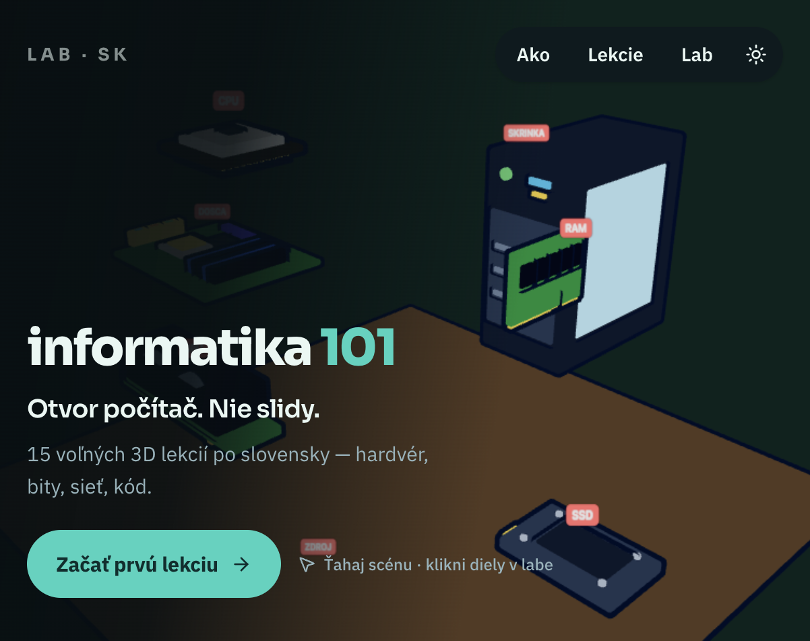
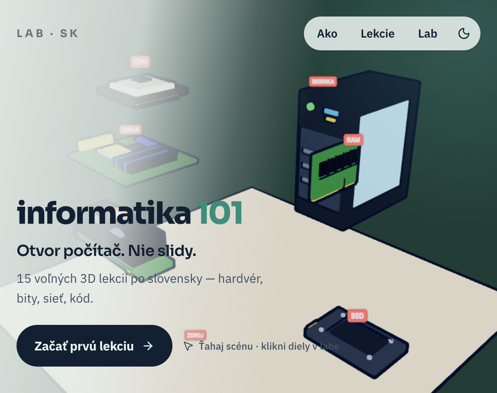
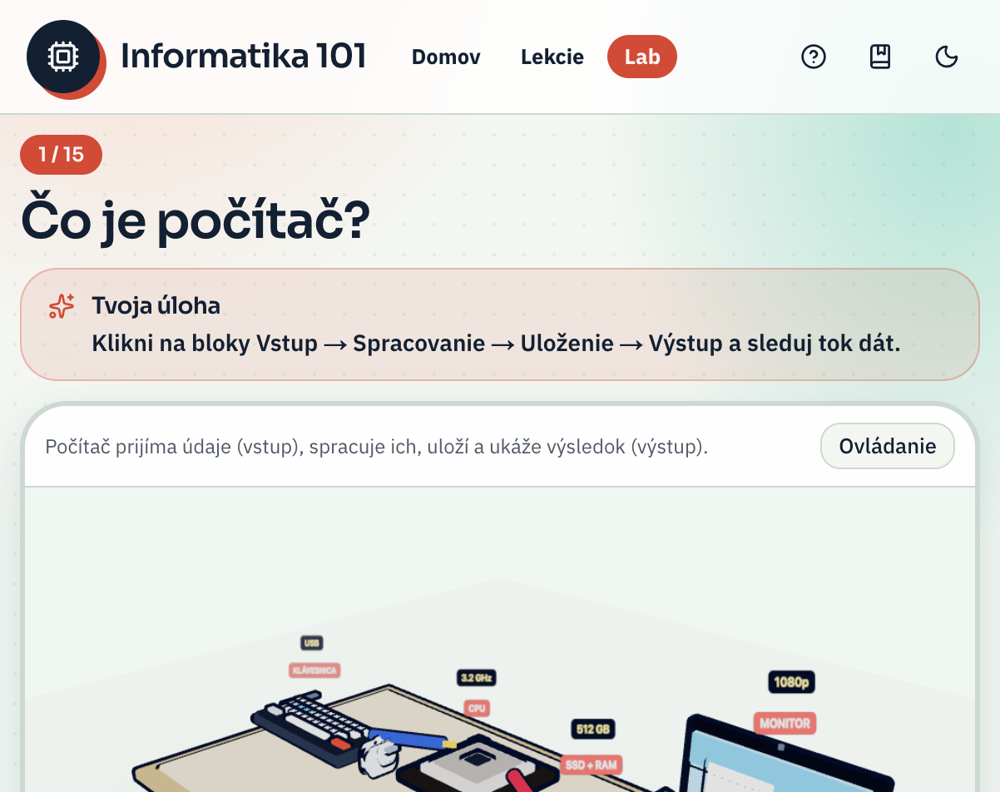
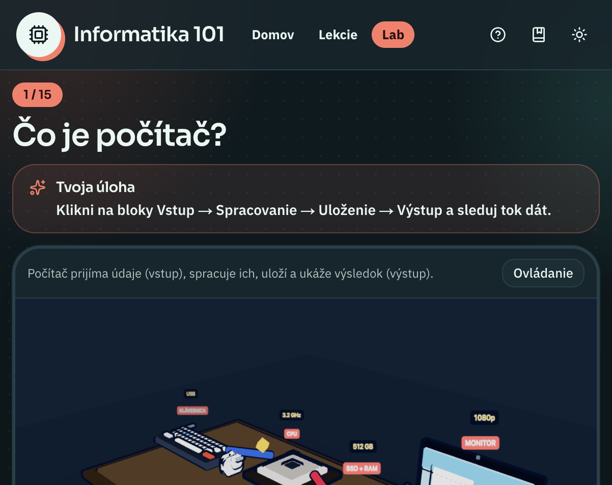
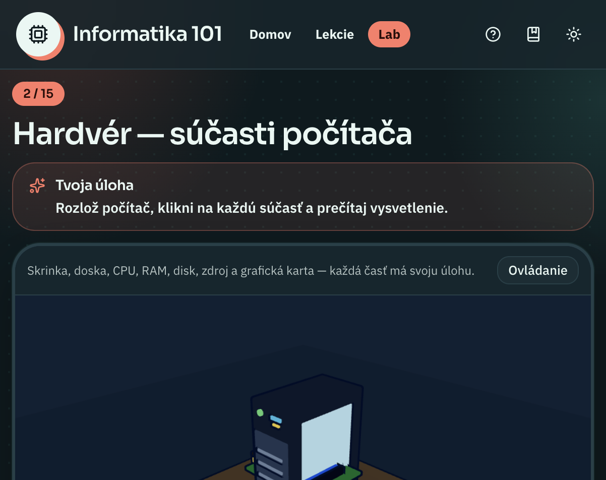

# Informatika 101 — Virtuálny počítač

Interaktívny **3D lab** po slovensky. Namiesto slidov otváraš počítač, klikáš na diely, sleduješ tok dát a overíš si to krátkym kvízom.

15 voľných lekcií · SK / EN / CS · light / dark · bez účtu · postup v prehliadači

<p align="center">
  
</p>

<p align="center">
  
</p>

---

## Čo to je

Žiaci a začiatočníci si môžu **ohmatať** hardvér, bity, CPU, sieť, kód aj bezpečnosť v toon 3D scéne:

- klik na diel = detail + zoom kamery  
- skladanie / odoberanie častí  
- úloha v každej lekcii + mini kvíz  
- light & dark mode  
- postup uložený v `localStorage` (Zustand)

<p align="center">
  
</p>

<p align="center">
  
</p>

<p align="center">
  
</p>

---

## Stack

| Vrstva | Technológia |
| --- | --- |
| App | Next.js 16 (App Router) · React 19 · TypeScript |
| UI | Tailwind CSS v4 · shadcn/ui · next-themes |
| 3D | Three.js · React Three Fiber · Drei |
| Stav | Zustand (postup lekcií) |

---

## Spustenie

```bash
npm install
npm run dev
```

Otvor [http://localhost:3000](http://localhost:3000).

```bash
npm run build && npm start   # produkcia
npm run lint
```

---

## Navigácia

| Cesta | Obsah |
| --- | --- |
| `/[locale]` | Landing + 3D hero (`sk` · `en` · `cs`) |
| `/[locale]/lesson/[id]` | Lab lekcie (3D + úloha + kvíz) |
| `/lekcia/*` | Redirect na `/sk/lesson/*` (legacy) |

Príklad: [`/sk/lesson/what-is-a-computer`](http://localhost:3000/sk/lesson/what-is-a-computer) · [`/en/…`](http://localhost:3000/en/lesson/what-is-a-computer)

---

## Lekcie (15)

| # | ID | Téma |
| ---: | --- | --- |
| 01 | `what-is-a-computer` | Čo je počítač? |
| 02 | `hardware` | Hardvér |
| 03 | `bits-and-bytes` | Bity a bajty |
| 04 | `cpu` | Procesor |
| 05 | `memory` | Pamäť |
| 06 | `operating-system` | Operačný systém |
| 07 | `logic-gates` | Logické hradlá |
| 08 | `networking` | Sieť |
| 09 | `programming` | Základy kódu |
| 10 | `security` | Bezpečnosť |
| 11 | `files-and-folders` | Súbory |
| 12 | `algorithms` | Algoritmy |
| 13 | `databases` | Databázy |
| 14 | `web-and-html` | Web |
| 15 | `ai-basics` | AI |

Každá lekcia má 3D scénu, úlohu, rýchlu kontrolu a kvíz (aspoň 2/3 na odznak). Všetky lekcie sú voľné (free-explore).

---

## Štruktúra projektu

```
src/
  app/                 # routes, SEO, loading
  components/
    lab/               # landing, rail, spinner, shell
    scenes/            # 3D scény lekcií
    three/             # Canvas3D, inspect, kamera
  data/                # lekcie + lab diely
  lib/                 # store, SEO, utils
docs/screenshots/      # náhľady do README
```

---

## Poznámky k UX

- **Fullscreen spinner** kým sa WebGL scéna nenakreslí (celá appka).  
- Zmena light/dark **nepremountuje** canvas — mení sa len pozadie a materiály.  
- Progressive loading hero 3D na landingu (`requestIdleCallback` + dynamic import).

---

## Licencia

Private / školský projekt — uprav podľa potreby.
